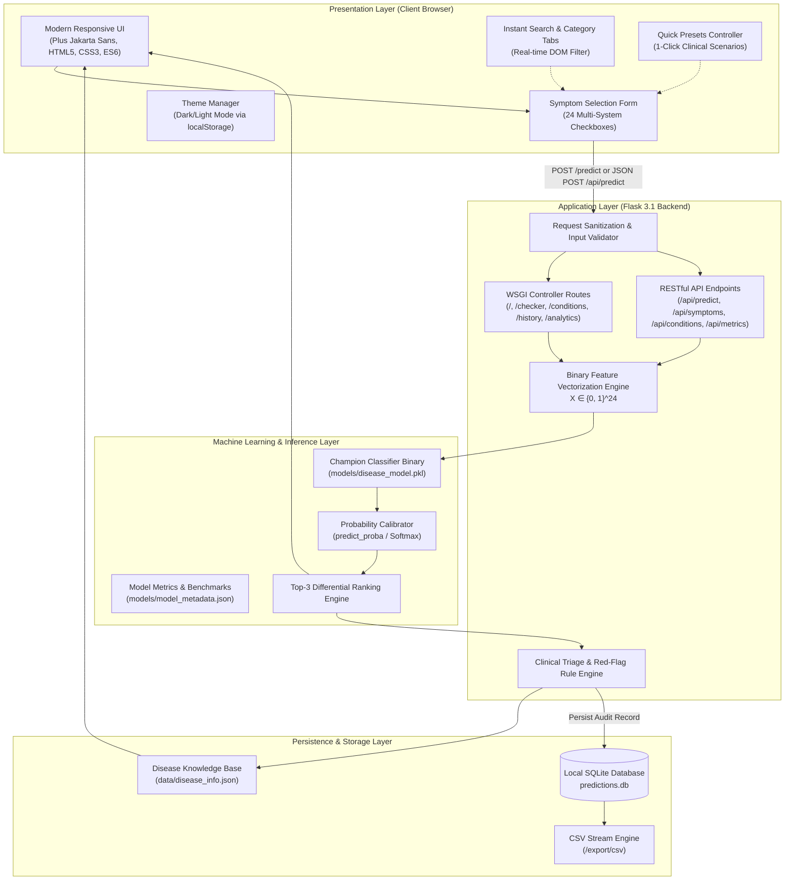
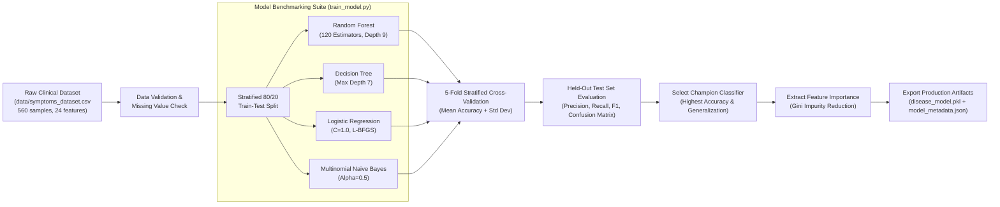
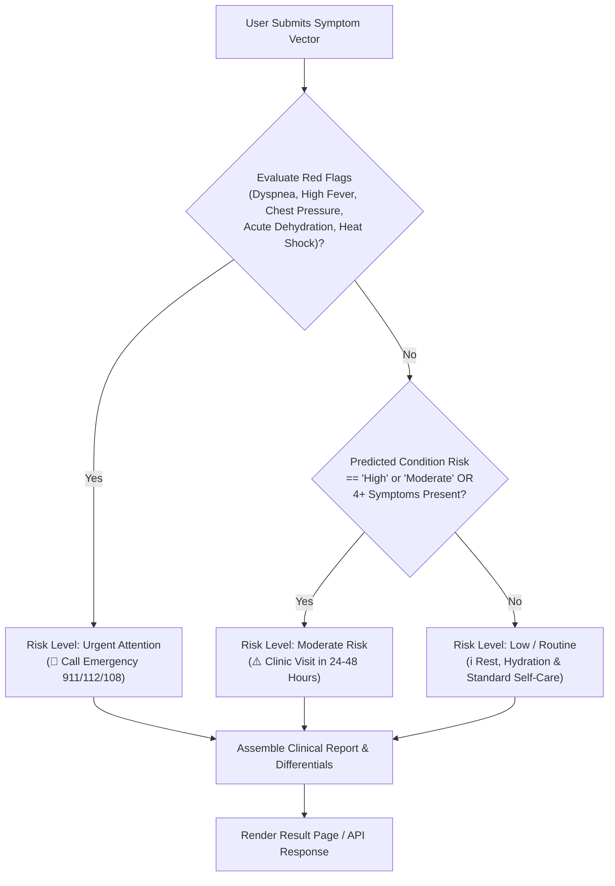
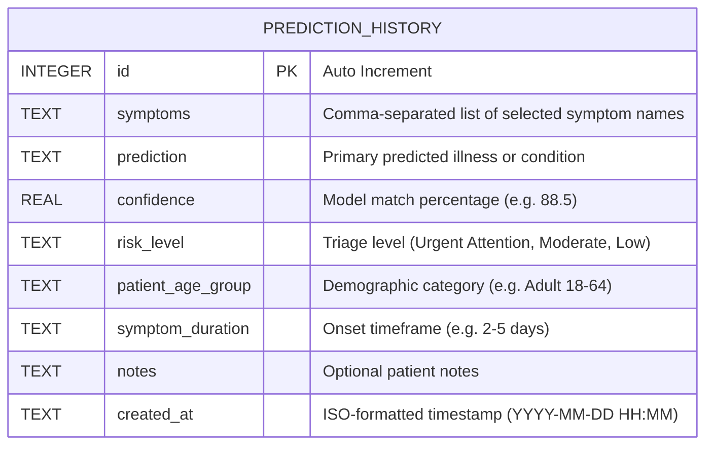

# System Architecture & Technical Specifications — MediPredict AI

MediPredict AI is designed as a modular, decoupled full-stack machine learning web application. It integrates supervised multi-class classification algorithms, probabilistic differential diagnosis calculation, clinical triage heuristics, and local privacy-preserving SQLite auditing.

---

## 1. High-Level System Architecture

---

## 2. Machine Learning Training & Evaluation Pipeline

---

## 3. Clinical Triage & Risk Decision Logic

---

## 4. Database Entity-Relationship (ER) Model

---

## 5. Technology Stack Summary

| Layer | Component | Version | Role |
| :--- | :--- | :--- | :--- |
| **Backend Runtime** | Python | 3.13 | Core computation and execution environment |
| **Web Framework** | Flask | 3.1.3 | WSGI routing, templating, request validation, REST API |
| **Machine Learning** | Scikit-learn | 1.9.1 | Model training, cross-validation, probability estimation |
| **Data Manipulation** | Pandas & NumPy | 3.0 / 2.5 | Matrix vectorization and DataFrame processing |
| **Database** | SQLite3 | 3.x embedded | Relational storage for local prediction audit trails |
| **Frontend** | HTML5 / CSS3 / ES6 | Modern | Responsive UI, theme switching, dynamic client filtering |
